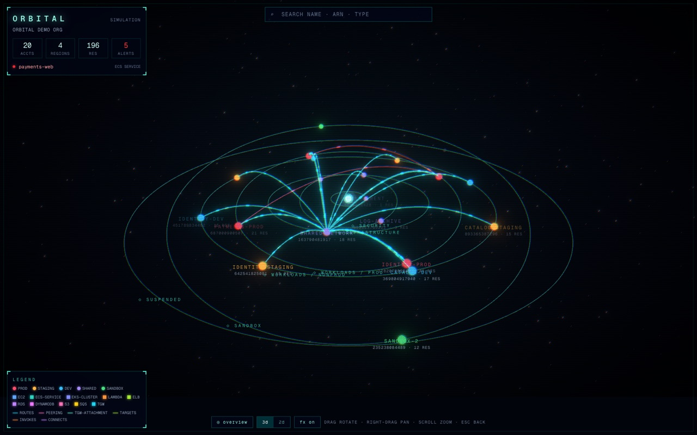
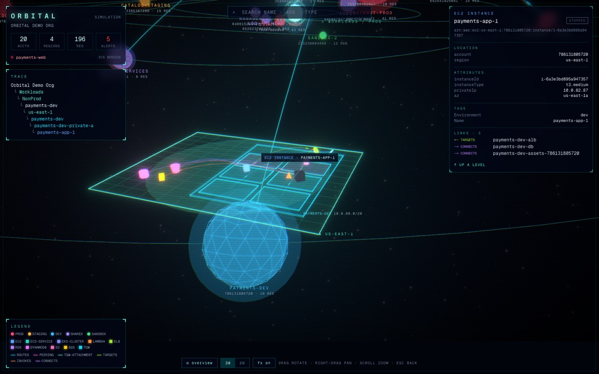
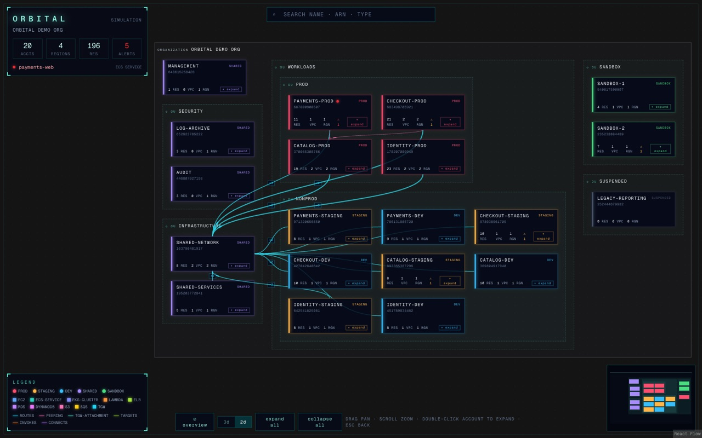
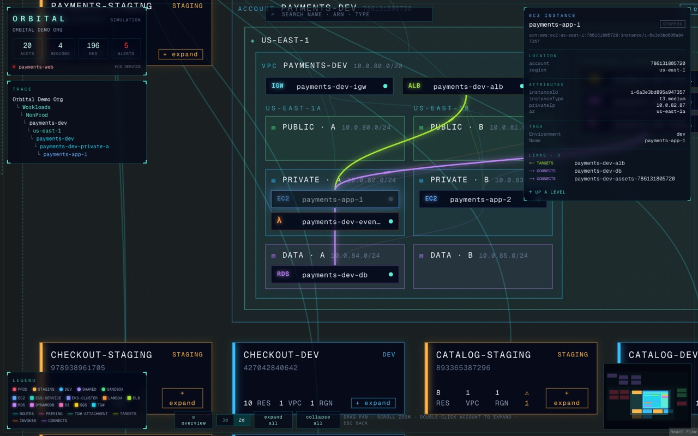

# Mizar

AWS infrastructure visualizer

**See your whole AWS estate at once.** Mizar maps your AWS accounts - a whole Organization with its OUs, or just
the accounts you pick - down to regions, VPCs, subnets and the resources inside them, plus how they connect, as an
interactive sci-fi 3D scene or a clean 2D architecture diagram. Self-hosted, read-only, and your data never leaves your AWS account.

> **Status: early development.** The visualization, snapshot pipeline and CLI work today against a built-in
> **simulated organization**. The first collector for real AWS accounts (direct read-only API calls) is
> **experimental**. Nothing is published to a container registry or AWS Marketplace yet.

| 3D - organization | 3D - account hologram |
|---|---|
|  |  |
| **2D - organization** | **2D - account detail** |
|  |  |

## What it does

- **3D view** - the organization is a glowing core; each OU is an orbital ring; each account is a planet colored by
  environment. Fly closer and an account unfolds into a hologram: region layers → VPC platforms → subnet tiles →
  resources. Cross-account links (transit gateway attachments, VPC peering) arc between planets.
- **2D view** - the same data as an AWS-style architecture diagram: OU boxes packed with account cards; expand an
  account to see VPCs with AZ columns × public/private/data subnet rows and every resource inside.
- **Find and follow** - search by name, ARN or type; click anything for its attributes, tags, contents and
  relationships; jump between connected resources; trace the path from the organization down to any resource.
- **Health at a glance** - critical resources pulse red, warnings glow amber, stopped resources dim; an alert list
  links straight to each problem.
- **Shareable links** - the URL keeps the view and selection (`/?view=2d#payments-prod`), so a link opens exactly
  what you were looking at.
- **Snapshots, not live calls** - a collector takes periodic snapshots; the web app only reads them, so browsing never
  hammers (or gets throttled by) AWS APIs.

## How it works

```
collector ──▶ snapshot store ──▶ web app (Next.js) ──▶ 2D / 3D views in the browser
(scheduled)    (file, S3, …)     reads latest snapshot
```

- A **collector** produces one complete snapshot of your infrastructure as a graph: containment (organization → OU →
  account → region → VPC → subnet → resource) plus relationships (`routes`, `peering`, `tgw-attachment`, `targets`,
  `invokes`, `connects`). Every snapshot is validated before it is saved.
- The **snapshot store** keeps recent snapshots. It is pluggable; a local directory is the zero-setup default.
- The **web app** renders the latest snapshot. The [snapshot format](#snapshot-format) is the contract between the
  two, so other collectors or views can build on it.

Design principles: **read-only** access, **no data leaves your account**, **no telemetry**, and nothing assumed about
your deployment - which account hosts it, where it runs and where snapshots live are all configuration.

## Quick start

Requires **Node.js 20.9+**. No AWS account is needed to try it.

```bash
git clone <repository-url> mizar && cd mizar
npm install

npm run mizar -- collect     # take a snapshot of the simulated organization
npm run dev                  # open http://localhost:3000
```

Run `collect` again any time; the page shows the newest snapshot on the next load. For a production build:

```bash
npm run build
npm start
```

Both servers listen on `127.0.0.1` only. To let other people in, configure [sign-in](#sign-in).

### Map your own AWS accounts (experimental)

Mizar uses whatever credentials the AWS SDK finds (a profile with `aws sso login`, environment variables, or an
instance/task role) and only ever reads.

```bash
# Just the account your credentials belong to - the quickest way to try it:
AWS_PROFILE=my-profile npm run mizar -- collect --source aws --scope current

# A whole AWS Organization, from the management account or a delegated administrator,
# assuming the read-only role MizarReadOnly in every member account:
AWS_PROFILE=org-admin npm run mizar -- collect --source aws

# Only some accounts and regions:
npm run mizar -- collect --source aws --scope accounts --accounts 111111111111,222222222222 --regions us-east-1,eu-west-1
```

Each member account needs a role (default name `MizarReadOnly`) that the collecting identity may assume, with
the [read-only permissions below](#aws-permissions).

What the collector maps, and how things connect:

| Area | Resources | Relationships |
|---|---|---|
| Network | VPCs, subnets (public/private/data tiers), internet and NAT gateways, transit gateways, Site-to-Site VPN (virtual private gateways, VPN connections with their customer gateway and tunnel status), Network Firewall | Routes (including through firewall endpoints and internet gateway ingress routing), VPC peering, transit gateway attachments (also across accounts), VPN connection → virtual private gateway or transit gateway |
| Edge and APIs | CloudFront distributions, API Gateway REST, HTTP and WebSocket APIs | Distribution → origin (S3, load balancer, API); API → Lambda, SQS or load balancer (VPC links) |
| Compute | EC2 instances, Application/Network Load Balancers, ECS services, EKS clusters, Lambda functions, WorkSpaces (one node per directory) | Load balancer → targets; event sources → Lambda |
| Data | RDS instances, ElastiCache (Redis, Valkey, Memcached, serverless), DynamoDB tables, S3 buckets, SQS queues | App (including WorkSpaces) → RDS / ElastiCache, inferred from security group references; read replicas |
| Health | Firing CloudWatch alarms on any of the above; security groups exposing admin or database ports to the internet | |

CloudFront is global: distributions appear under `us-east-1`, whatever `aws.regions` says. A VPN connection
represents the link to your office or data centre: its customer gateway (public IP, BGP ASN, device) is shown on it,
and it turns amber when one tunnel is down and red when all are. A Network Firewall shows its policy, endpoints
and sync status (its rules aren't read); subnets whose internet traffic is inspected on the way out still count as
public. WorkSpaces are summarised per directory (how many, how many available, stopped or unhealthy, running modes)
rather than drawn one desktop at a time, so user names stay out of the map.

**Large organizations: use an AWS Config aggregator.** If you already aggregate AWS Config across the organization,
one query in the aggregator account replaces thousands of per-account, per-region API calls:

```bash
npm run mizar -- collect --source aws --inventory config   # with aws.configAggregator set, e.g.
MIZAR_AWS_CONFIG_AGGREGATOR=my-org-aggregator npm run mizar -- collect --source aws --inventory config
```

Config records configuration, not live state, so by default Mizar still assumes the read-only role where Config
found something it can't fully describe: load balancer targets and their health, ECS task counts, Lambda event
sources, alarm states, API Gateway integrations, VPN tunnel status, firewall status and WorkSpaces states and
directories. AWS Config doesn't record ElastiCache at all, so enrichment also
lists caches directly in regions that have a VPC of their own (not just the default VPC). Set `aws.enrich` to
`false` to never assume member roles; the map then shows everything except those details (and no caches; VPN
connections without tunnel status, firewalls without status, WorkSpaces counted per directory in their region). Only resource types your Config recorders record appear. Accounts that can't be entered and APIs that are denied are
reported as warnings on the account and in the log; the rest of the snapshot is still saved.

### Getting around

| | 3D | 2D |
|---|---|---|
| Move | Left-drag rotate · right-drag pan · scroll zoom | Drag pan · scroll zoom · minimap |
| Drill in | Click a planet or resource; nearby accounts unfold automatically | Double-click an account or use `+ expand`; expand all / collapse all |
| Back out | `Esc`, **overview**, or **↑ up a level** in the details panel | same |

Both views share search, selection, the details and trace panels, and the legend - click a relationship type in the
legend to hide or show those lines. Switch views with the **3d / 2d** toggle; **fx** turns 3D post-processing off on
slower machines.

When the snapshot has [costs](#costs-optional), the summary shows the organization's spend this month and last
month with the biggest accounts, the details panel adds a Cost section (top services, share of the organization), and
**env / cost** colours accounts by spend instead of environment (log scale, cheapest to biggest account). Links keep
the view, colouring and selection: `/?view=2d&color=cost#payments-prod`. The simulated organization has made-up
costs, so you can try it without AWS.

## Sign-in

Mizar signs users in with any OpenID Connect provider, or with a SAML 2.0 provider such as IAM Identity Center
([below](#saml-and-iam-identity-center)).

### OpenID Connect

Mizar works with any OpenID Connect provider (Okta, Microsoft Entra ID, Google, Keycloak, Amazon Cognito, Auth0, ...),
using the authorization code flow with PKCE. Register a web application with your provider, with redirect URI
`<public URL>/auth/callback`, then set:

```sh
MIZAR_AUTH_ISSUER=https://login.example.com/oauth2/default   # discovered via /.well-known/openid-configuration
MIZAR_AUTH_CLIENT_ID=...
MIZAR_AUTH_CLIENT_SECRET=...            # omit for a public client
MIZAR_AUTH_PUBLIC_URL=https://mizar.internal.example.com
MIZAR_AUTH_SESSION_SECRET=$(openssl rand -base64 32)   # same value on every replica
MIZAR_AUTH_ALLOWED_DOMAINS=example.com  # optional; or ALLOWED_EMAILS / ALLOWED_GROUPS
```

### SAML and IAM Identity Center

For providers that don't offer OpenID Connect to your own applications, Mizar signs users in with SAML 2.0. IAM
Identity Center is one, whatever its identity source: its own directory, an external provider, or AWS Managed
Microsoft AD (users sign in with their AD credentials on the Identity Center page). Mizar sends users to the
provider and only accepts a signed response to a sign-in it started, posted back to `<public URL>/auth/saml/acs`.

Set up Identity Center first (in its home region and account, the management account or a delegated administrator):

1. **Applications → Customer managed → Add application → I have an application I want to set up → SAML 2.0.**
2. Name it (say `Mizar`). Under **IAM Identity Center metadata**, copy the **IAM Identity Center sign-in URL** and
   **IAM Identity Center SAML issuer URL**, and download the **IAM Identity Center certificate**.
3. **Application start URL:** `https://mizar.example.com/auth/login`, so the tile in the AWS access portal starts
   the sign-in from Mizar (Mizar refuses sign-ins it didn't start).
4. **Application metadata → Manually type your metadata values:**
   - **Application ACS URL:** `https://mizar.example.com/auth/saml/acs`
   - **Application SAML audience:** `https://mizar.example.com` (your public URL, or `auth.saml.entityId`)
5. Submit, then **Actions → Edit attribute mappings:**

   | User attribute in the application | Maps to | Format |
   |---|---|---|
   | `Subject` | `${user:subject}` | `persistent` |
   | `email` | `${user:email}` | `unspecified` |
   | `name` | `${user:name}` | `unspecified` |

6. **Assign users and groups:** only assigned users can sign in, so assign the groups who should see the map (for
   AWS Managed Microsoft AD, groups Identity Center syncs from the directory, such as `Mizar-Users`). This is the
   simplest access control: leave Mizar's allow lists empty. Users need an email address in the directory (`mail`
   in AD) for `ALLOWED_EMAILS` and `ALLOWED_DOMAINS` to match them.

Then set:

```sh
MIZAR_AUTH_SAML_ENTRY_POINT=https://portal.sso.us-east-1.amazonaws.com/saml/assertion/...  # sign-in URL
MIZAR_AUTH_SAML_IDP_CERT="$(cat "IAM Identity Center Certificate.pem")"  # or the base64 between BEGIN and END
MIZAR_AUTH_SAML_IDP_ISSUER=https://portal.sso.us-east-1.amazonaws.com/saml/assertion/...   # SAML issuer URL
MIZAR_AUTH_PUBLIC_URL=https://mizar.example.com
MIZAR_AUTH_SESSION_SECRET=$(openssl rand -base64 32)   # same value on every replica
```

- **Certificate rotation:** Mizar trusts one certificate. When you rotate Identity Center's certificate for the
  application, update `MIZAR_AUTH_SAML_IDP_CERT` as you make the new one active.
- **The login cookie is `SameSite=None`**, because the response is a form post from the provider's site. It is
  still HttpOnly, `__Host-` and encrypted, and only valid for 10 minutes. Browsers only accept such cookies over
  HTTPS, so SAML sign-in needs an `https://` public URL.
- **Signing out** ends the Mizar session only, as with OpenID Connect.

### Sessions and modes

- **Who gets in:** everyone your provider authenticates for this application, unless you set allow lists. Emails
  and domains only count when the provider hasn't marked the email unverified; groups come from the ID token's
  `groups` claim, or a SAML attribute of that name (`auth.groupsClaim`), which most providers only send when
  configured to.
- **Sessions** are encrypted, HttpOnly cookies (`__Host-` over HTTPS) lasting `auth.sessionHours` (12 by default).
  Nothing is stored on the server. Signing out ends the Mizar session, not the provider's.
- **Every page and API request** is checked before routing, and again where the snapshot is read.
- **Modes** (`auth.mode`): `oidc` when an issuer is set, `saml` when a SAML entry point is set. Otherwise
  `localhost`: no sign-in, the server listens on
  `127.0.0.1` only and answers only requests addressed to `localhost`, so other machines and web pages (DNS
  rebinding) can't read the map. `none` turns all checks off. Use it only when something in front already
  authenticates every request, such as an ALB with OIDC or an SSM port-forwarding session.

## CLI

```text
npm run mizar -- collect [--source mock|aws] [--every <minutes>]   Take a snapshot (once, or repeatedly)
        [--scope organization|accounts|current] [--accounts <id,...>] [--regions <region,...>]
npm run mizar -- snapshots [--limit <n>]                           List stored snapshots, newest first
npm run mizar -- validate <file.json>...                           Check snapshot files against the contract
npm run mizar -- config                                            Print the effective configuration
```

`--every` keeps collecting on a schedule (runs never overlap) and stops cleanly on `SIGINT`/`SIGTERM`, which suits
containers and service managers.

## Snapshot format

Every snapshot is one JSON document, `InfraGraph` version 1, described by the JSON Schema
[`schema/infra-graph.v1.schema.json`](schema/infra-graph.v1.schema.json) (draft 2020-12). It is the contract
between collectors and views: anything that writes valid snapshots into a store can feed Mizar, and anything that
reads them can render or analyse an estate. The format changes only with a new `version`.

- **Nodes** form one tree through `parentId`: organization → OU → account → region → VPC → subnet → resource.
  Regional services that live outside VPCs (S3, SQS, DynamoDB, transit gateways, VPN connections, Lambda, API Gateway) hang off the
  region, and CloudFront (global) off `us-east-1`;
  Availability Zones are a subnet attribute (`az`), not nodes. Ids are ARNs where AWS has one.
- **Edges** are every other relationship: `routes`, `peering`, `tgw-attachment`, `vpn`, `targets`, `invokes`, `connects`.
- Beyond the schema: node and edge ids are unique, exactly one node (the organization) has no parent, and every
  `parentId`, `from` and `to` names an existing node.

Mizar checks all of this before saving a snapshot and again whenever it reads one, so a malformed snapshot fails
with a reason instead of breaking the views. Check your own with `mizar validate <file.json>`.

## Docker

One image runs both halves: `serve` (the default) is the web app on port 3000, and any CLI command (`collect`,
`snapshots`, `config`) runs the collector. Run them as two containers that share a store and the same settings.

```sh
docker build -t mizar .

# Shared snapshot volume; simulated data to start with:
docker volume create mizar-data
docker run --rm -v mizar-data:/app/data mizar collect --source mock
# Without sign-in the server only listens inside the container; MIZAR_AUTH_MODE=none for a quick local look:
docker run -d --name mizar -p 127.0.0.1:3000:3000 -e MIZAR_AUTH_MODE=none -v mizar-data:/app/data mizar

# Collector for real accounts, every hour, into S3 (no shared volume needed):
docker run -d --name mizar-collect \
  -e MIZAR_STORE=s3://my-bucket/mizar -e MIZAR_SOURCE=aws -e AWS_REGION=eu-west-1 \
  mizar collect --every 60
```

- **Settings:** `MIZAR_*` environment variables, or mount a file at `/app/mizar.config.json` (or set
  `MIZAR_CONFIG`). Give both containers the same store.
- **AWS credentials** come from the SDK default chain, as outside Docker: an ECS task role, EKS pod identity or
  IRSA, the EC2 instance profile (on EC2, set the IMDSv2 hop limit to 2 so containers can reach it), or locally
  `-v ~/.aws:/home/node/.aws:ro -e AWS_PROFILE=<profile>` after `aws sso login` on the host.
- **Storage:** with the default `file://` store, mount a volume at `/app/data`, the only writable path. The
  container runs as the unprivileged `node` user. Use `s3://` when the two containers run on different hosts.
- **Access:** configure [sign-in](#sign-in) for anything beyond a look on your own machine. Without it, `serve`
  listens on the container's loopback only (unreachable through a published port) unless you set
  `MIZAR_AUTH_MODE=none`, in which case publish the port to `127.0.0.1` only, as above.

## Configuration

Settings are merged in this order (later wins): built-in defaults → `mizar.config.json` (or the file named by
`MIZAR_CONFIG`) → environment variables → CLI flags. See
[`mizar.config.example.json`](mizar.config.example.json).

| Setting | Environment variable | Default | Description |
|---|---|---|---|
| `store` | `MIZAR_STORE` | `file://./data/snapshots` | Where snapshots are kept |
| `retain` | `MIZAR_RETAIN` | `48` | Snapshots to keep; older ones are deleted after each save |
| `source` | `MIZAR_SOURCE` | `mock` | Which collector to run |
| `mock.teams` | - | `4` | Simulated org size: 3 accounts per team (try `60` for ~190 accounts) |
| `mock.sandboxes` | - | `2` | Simulated sandbox accounts |
| `mock.seed` | - | `42` | Same seed, same simulated org |
| `aws.scope` | `MIZAR_AWS_SCOPE` | `organization` | `organization` (every active account), `accounts` (only `aws.accounts`) or `current` (the caller's account) |
| `aws.accounts` | `MIZAR_AWS_ACCOUNTS` | - | Account ids for scope `accounts` (comma-separated in the variable) |
| `aws.excludeAccounts` | `MIZAR_AWS_EXCLUDE_ACCOUNTS` | - | Account ids never collected |
| `aws.regions` | `MIZAR_AWS_REGIONS` | every enabled region | Regions to scan |
| `aws.region` | `MIZAR_AWS_REGION` | the SDK's region (`AWS_REGION` or the profile's), else `us-east-1` | Region used for STS, Organizations, region discovery and (by default) the Config aggregator |
| `aws.roleName` | `MIZAR_AWS_ROLE_NAME` | `MizarReadOnly` | Role assumed in each collected account |
| `aws.rolePath` | - | `/` | IAM path of that role |
| `aws.externalId` | `MIZAR_AWS_EXTERNAL_ID` | - | External id required by the role's trust policy (masked in output) |
| `aws.assumeRoleInCallerAccount` | - | `false` | Assume the role in the collecting account too, instead of using the caller's own credentials |
| `aws.inventory` | `MIZAR_AWS_INVENTORY` | `direct` | `direct` (service APIs in every account and region) or `config` (an AWS Config aggregator) |
| `aws.configAggregator` | `MIZAR_AWS_CONFIG_AGGREGATOR` | - | Aggregator name, for inventory `config` |
| `aws.configAggregatorRegion` | `MIZAR_AWS_CONFIG_AGGREGATOR_REGION` | `aws.region` | The aggregator's region |
| `aws.enrich` | `MIZAR_AWS_ENRICH` | `true` | With inventory `config`, assume member roles to add what Config doesn't record |
| `aws.cost.enabled` | `MIZAR_AWS_COST` | `false` | Add spend per account, region and top services from Cost Explorer. **Adds AWS charges** ($0.01 per request, at least 2 per collection; see [Costs](#costs-optional)) |
| `aws.cost.accountId` | `MIZAR_AWS_COST_ACCOUNT_ID` | the management account, else the caller's | Account costs are read from |
| `aws.cost.roleName` / `.rolePath` | `MIZAR_AWS_COST_ROLE_NAME` / - | `MizarCostReader` / `/` | Role assumed there, unless it is the collecting account |
| `aws.cost.metric` | `MIZAR_AWS_COST_METRIC` | `UnblendedCost` | `UnblendedCost`, `NetUnblendedCost`, `AmortizedCost`, `NetAmortizedCost` or `BlendedCost` |
| `aws.name` | - | organization id | Display name for the organization |
| `aws.includeEmptyDefaultVpcs` | - | `false` | Show default VPCs that contain nothing |
| `aws.concurrency.accounts` / `.regions` | - | `4` / `4` | Accounts, and regions per account, collected in parallel |
| `ui.costs` | `MIZAR_UI_COSTS` | `true` | Show spend in the web app; `false` removes every cost figure on the server before snapshots reach the browser or `/api/graph` |
| `auth.mode` | `MIZAR_AUTH_MODE` | `oidc` with an issuer, `saml` with an entry point, else `localhost` | `oidc`, `saml`, `localhost` (no sign-in, loopback only) or `none` (no checks) |
| `auth.issuer` | `MIZAR_AUTH_ISSUER` | - | OpenID Connect issuer URL |
| `auth.clientId` | `MIZAR_AUTH_CLIENT_ID` | - | Client id registered with the provider |
| `auth.clientSecret` | `MIZAR_AUTH_CLIENT_SECRET` | - | Client secret; omit for a public client (masked in output) |
| `auth.publicUrl` | `MIZAR_AUTH_PUBLIC_URL` | - | URL users open; the redirect URI is `<publicUrl>/auth/callback` |
| `auth.sessionSecret` | `MIZAR_AUTH_SESSION_SECRET` | - | 32+ characters, encrypts session cookies (masked in output) |
| `auth.sessionHours` | `MIZAR_AUTH_SESSION_HOURS` | `12` | How long a sign-in lasts |
| `auth.scopes` | - | `["openid", "email", "profile"]` | Scopes requested from the provider |
| `auth.allowedEmails` / `.allowedDomains` / `.allowedGroups` | `MIZAR_AUTH_ALLOWED_EMAILS` / `_DOMAINS` / `_GROUPS` | - | Who may sign in (comma-separated in the variables); none set: anyone the provider authenticates |
| `auth.groupsClaim` | - | `groups` | ID token claim (or SAML attribute) holding the user's groups |
| `auth.saml.entryPoint` | `MIZAR_AUTH_SAML_ENTRY_POINT` | - | SAML provider's sign-in URL |
| `auth.saml.idpCert` | `MIZAR_AUTH_SAML_IDP_CERT` | - | Provider's signing certificate: PEM, or the base64 between its BEGIN and END lines |
| `auth.saml.idpIssuer` | `MIZAR_AUTH_SAML_IDP_ISSUER` | - | Issuer the provider's assertions must name; unchecked when unset |
| `auth.saml.entityId` | `MIZAR_AUTH_SAML_ENTITY_ID` | `auth.publicUrl` | This app's entity id: the audience assertions must be addressed to |

Supported stores:

- `file://<directory>` (or a plain path): one JSON file per snapshot. Zero setup; fine for a single host.
- `s3://<bucket>[/<prefix>][?region=<region>&endpoint=<url>]`: one object per snapshot, so the collector and web
  app can run on different hosts or containers. Credentials come from the AWS SDK default provider chain, never the
  URL. `region` defaults to the SDK's (wrong-region requests are redirected); `endpoint` points at an S3-compatible
  service such as MinIO or LocalStack. Encryption follows the bucket's default encryption (SSE-S3 or your KMS key).
  The collector needs `s3:ListBucket` on the bucket and `s3:GetObject`, `s3:PutObject` and `s3:DeleteObject` (for
  retention) on `<bucket>/<prefix>/*`; the web app only `s3:ListBucket` and `s3:GetObject`. Turn on Block Public
  Access: a snapshot maps your whole estate.

`sqlite://` and `postgres://` are planned. Credentials in store URLs are always masked in output.

### AWS permissions

The collecting identity needs `sts:AssumeRole` on the member role and, for scope `organization` (and to show OU
structure otherwise), `organizations:DescribeOrganization`, `ListRoots`, `ListOrganizationalUnitsForParent`,
`ListAccountsForParent` and `ListTagsForResource`. With `aws.inventory: "config"` it also needs
`config:SelectAggregateResourceConfig` and `config:DescribeConfigurationAggregatorSourcesStatus` (the latter only to
report accounts the aggregator doesn't cover). In each collected account, the read-only role needs:

```json
{
  "Version": "2012-10-17",
  "Statement": [{
    "Effect": "Allow",
    "Action": [
      "ec2:DescribeRegions", "ec2:DescribeVpcs", "ec2:DescribeSubnets", "ec2:DescribeInternetGateways",
      "ec2:DescribeNatGateways", "ec2:DescribeTransitGateways", "ec2:DescribeTransitGatewayVpcAttachments",
      "ec2:DescribeRouteTables", "ec2:DescribeVpcPeeringConnections", "ec2:DescribeVpnGateways",
      "ec2:DescribeVpnConnections", "ec2:DescribeCustomerGateways", "ec2:DescribeInstances",
      "ec2:DescribeSecurityGroups",
      "network-firewall:ListFirewalls", "network-firewall:DescribeFirewall",
      "elasticloadbalancing:DescribeLoadBalancers", "elasticloadbalancing:DescribeTargetGroups",
      "elasticloadbalancing:DescribeTargetHealth",
      "ecs:ListClusters", "ecs:ListServices", "ecs:DescribeServices",
      "eks:ListClusters", "eks:DescribeCluster",
      "lambda:ListFunctions", "lambda:ListEventSourceMappings",
      "rds:DescribeDBInstances",
      "elasticache:DescribeReplicationGroups", "elasticache:DescribeCacheClusters",
      "elasticache:DescribeCacheSubnetGroups", "elasticache:DescribeServerlessCaches",
      "workspaces:DescribeWorkspaceDirectories", "workspaces:DescribeWorkspaces",
      "dynamodb:ListTables", "dynamodb:DescribeTable",
      "sqs:ListQueues",
      "s3:ListAllMyBuckets",
      "cloudfront:ListDistributions",
      "cloudwatch:DescribeAlarms",
      "iam:ListAccountAliases"
    ],
    "Resource": "*"
  }, {
    "Effect": "Allow",
    "Action": ["apigateway:GET"],
    "Resource": [
      "arn:aws:apigateway:*::/restapis", "arn:aws:apigateway:*::/restapis/*/resources",
      "arn:aws:apigateway:*::/apis", "arn:aws:apigateway:*::/apis/*/integrations",
      "arn:aws:apigateway:*::/vpclinks"
    ]
  }]
}
```

`iam:ListAccountAliases` only names accounts that aren't read from an Organization. API Gateway has a single read
action, so it is limited to the paths Mizar reads: API lists, REST methods and integrations, HTTP API integrations
and VPC links (never API keys, stage variables or exported definitions). None of these read data: no object
contents, queue messages, table items, cache keys or secrets (Lambda environment variables are never requested).
One exception you should know about: AWS returns the tunnels' pre-shared keys in `ec2:DescribeVpnConnections`
responses (unless you keep them in Secrets Manager), and there is no way to ask for less. Mizar reads only the
connection's state, tunnel status, routing and gateway ids, and never stores, logs or displays the keys. AWS Config's
records of VPN connections may hold them too, and Mizar ignores them there as well. Remove the action from the
policies if you'd rather not grant it: the direct inventory then skips VPN connections with a warning.

### Costs (optional)

> [!WARNING]
> **Turning on costs adds charges to your AWS bill.** The Cost Explorer API costs **$0.01 per request**, and Mizar
> makes at least two requests on every collection (more when results page, for example in large organizations).
> Collecting hourly costs about **$15 a month** (2 × 24 × 30 = 1,440 requests); every 15 minutes, about $58.
> Costs are off by default; if you turn them on, collect less often to keep the charge down. See
> [AWS Cost Management pricing](https://aws.amazon.com/aws-cost-management/pricing/).

With `aws.cost.enabled`, the collector adds last month's and month-to-date spend from Cost Explorer to every
account and region, the top services per account, and totals on the organization. Credits and refunds are left out,
so the figures show what resources cost rather than what the invoice says; `aws.cost.metric` picks unblended
(default), net, amortized or blended cost. Cost Explorer must be enabled in the account, and figures lag AWS's own
billing by up to a day.

Only the management account sees every account's spend; any other account sees just its own. Costs are read from
`aws.cost.accountId`, by default the Organization's management account (else the collecting account), through the
`MizarCostReader` role there (`aws.cost.roleName`, with the same `aws.externalId`). When the collector runs in that
account itself, it uses its own credentials. To collect costs without showing them to everyone who can open Mizar,
set `ui.costs: false` on the web server. Either way, the identity reading costs needs only:

```json
{
  "Version": "2012-10-17",
  "Statement": [{
    "Effect": "Allow",
    "Action": ["ce:GetCostAndUsage"],
    "Resource": "*"
  }]
}
```

### Deploying the roles with CloudFormation

Two templates in [`deploy/cloudformation/`](deploy/cloudformation) create these roles:

- **`mizar-collector-role.yaml`**, in the account where Mizar runs: the `MizarCollector` role for an EC2
  instance (with an instance profile), ECS task or EKS pod (Pod Identity). It reads the Organization and the Config
  aggregator, inventories its own account directly, may assume only the member role elsewhere, and, given
  `StoreBucket`, reads and writes snapshots under one S3 prefix.
- **`mizar-member-role.yaml`**, in every collected account: the `MizarReadOnly` role above. Only the collector
  role may assume it (and only with `ExternalId`, if you set one).
- **`mizar-cost-role.yaml`** (optional, for `aws.cost`), as a plain stack in the management account: the
  `MizarCostReader` role, which may only call `ce:GetCostAndUsage`. Give the collector stack `CostAccountId` (the
  management account id): it then may assume this role, or, when the collector runs in the management account,
  reads Cost Explorer directly and needs no cost role.

Run Mizar from a dedicated tooling or security account that is a delegated administrator, rather than the
management account. Then:

```sh
# 1. In the hosting account:
aws cloudformation deploy --stack-name mizar-collector \
  --template-file deploy/cloudformation/mizar-collector-role.yaml --capabilities CAPABILITY_NAMED_IAM \
  --parameter-overrides ComputeService=ecs-tasks.amazonaws.com StoreBucket=my-bucket StorePrefix=mizar/

# 2. In the management account (or a StackSets delegated administrator, adding --call-as DELEGATED_ADMIN):
#    the read-only role in every member account, including accounts that join later.
aws cloudformation create-stack-set --stack-set-name mizar-member-role \
  --template-body file://deploy/cloudformation/mizar-member-role.yaml --capabilities CAPABILITY_NAMED_IAM \
  --permission-model SERVICE_MANAGED --auto-deployment Enabled=true,RetainStacksOnAccountRemoval=false \
  --parameters ParameterKey=CollectorAccountId,ParameterValue=<hosting account id>
aws cloudformation create-stack-instances --stack-set-name mizar-member-role \
  --deployment-targets OrganizationalUnitIds=<root id, r-...> --regions us-east-1   # IAM is global: one region

# 3. StackSets never deploy to the management account itself. To map it too, deploy the member role there as a
#    plain stack (step 1's `aws cloudformation deploy`, with this template and CollectorAccountId).
```

The two stacks can be created in either order. The hosting account needs no member role: the collector reads it
with its own credentials. If you change `RoleName`, `RolePath` or `ExternalId`, set the collector's `aws.roleName`,
`aws.rolePath` and `aws.externalId` to match. From a delegated administrator account, Organizations reads also need
the management account's [delegation policy](https://docs.aws.amazon.com/organizations/latest/userguide/orgs_delegate_policies.html)
to allow `DescribeOrganization`, `ListRoots`, `ListOrganizationalUnitsForParent`, `ListAccountsForParent` and
`ListTagsForResource`, and a Config aggregator must be created in (or authorized for) that account.

## Deploying on AWS

Two ready-made recipes in [`deploy/cloudformation/`](deploy/cloudformation) run Mizar in your hosting account.
Both keep it private and use the [collector role](#deploying-the-roles-with-cloudformation) deployed with the matching
`ComputeService`. A third, `mizar-lambda-web.yaml`, runs only the web app on
[Lambda Web Functions](#aws-lambda-web-functions-web-app-only), with the collector elsewhere.

| | EC2 (`mizar-ec2.yaml`) | ECS Fargate (`mizar-ecs.yaml`) |
|---|---|---|
| Runs | One instance: web app + collector as Docker containers under systemd | A web service, and a collector task started on a schedule |
| Snapshots | Encrypted instance volume | Private S3 bucket created by the stack (TLS only, no public access) |
| Access | Systems Manager port forwarding: no open ports, no load balancer | Internal HTTPS load balancer reachable from `AllowedCidr` |
| Sign-in | None needed: requests arrive on the instance's localhost | OpenID Connect (secrets in Secrets Manager) |
| Needs | A private subnet with outbound HTTPS | Private subnets, an ACM certificate and a DNS name |

**1. Publish the image** to a private ECR repository (both recipes default to Graviton/arm64):

```sh
aws ecr create-repository --repository-name mizar --image-scanning-configuration scanOnPush=true
aws ecr get-login-password | docker login --username AWS --password-stdin <account>.dkr.ecr.<region>.amazonaws.com
docker buildx build --platform linux/arm64 -t <account>.dkr.ecr.<region>.amazonaws.com/mizar:0.1.0 --push .
```

**2a. EC2**, with the collector role deployed as `ComputeService=ec2.amazonaws.com` (it then also has SSM
management and ECR pulls):

```sh
aws cloudformation deploy --stack-name mizar --template-file deploy/cloudformation/mizar-ec2.yaml \
  --parameter-overrides ImageUri=<image> VpcId=vpc-... SubnetId=subnet-... \
    ConfigJson='{"source": "aws", "aws": {"scope": "organization"}}'
# Then open Mizar through the tunnel printed in the stack's OpenMizar output, and browse http://localhost:3000:
aws ssm start-session --target <instance id> --document-name AWS-StartPortForwardingSession \
  --parameters portNumber=3000,localPortNumber=3000
```

The first snapshot appears after the first collection. Changing `ImageUri` or `ConfigJson` replaces the instance (and
its snapshots, which the next collection recreates); to pick up a new image under the same tag, run
`sudo systemctl restart mizar-web mizar-collect` on the instance.

**2b. ECS Fargate**, with the collector role deployed as `ComputeService=ecs-tasks.amazonaws.com`. For OpenID
Connect, register `https://<DomainName>/auth/callback` as the redirect URI with your identity provider first:

```sh
aws cloudformation deploy --stack-name mizar --template-file deploy/cloudformation/mizar-ecs.yaml \
  --capabilities CAPABILITY_IAM --parameter-overrides \
    ImageUri=<image> CollectorRoleArn=<RoleArn output> \
    VpcId=vpc-... TaskSubnetIds=subnet-a,subnet-b LoadBalancerSubnetIds=subnet-a,subnet-b AllowedCidr=10.0.0.0/8 \
    DomainName=mizar.internal.example.com CertificateArn=arn:aws:acm:... HostedZoneId=Z... \
    OidcIssuer=https://login.example.com OidcClientId=... OidcClientSecret=... AllowedDomains=example.com
```

For IAM Identity Center (SAML), set up the application as in [SAML and IAM Identity
Center](#saml-and-iam-identity-center) with `DomainName` as the public URL, then replace the `Oidc*` parameters with
`SamlEntryPoint`, `SamlIdpIssuer` and `SamlIdpCert` as in the [Lambda example](#aws-lambda-web-functions-web-app-only)
(the certificate as the base64 between its BEGIN and END lines, on one line). The `SamlAcsUrl` and `SamlAudience`
outputs repeat the values the Identity Center application needs.

Without `HostedZoneId`, point the DNS name at the `LoadBalancerDnsName` output yourself. The collector runs only
while it collects: EventBridge Scheduler starts one task every `CollectEveryMinutes`, and it stops when the snapshot
is saved, so you don't pay for it in between. The schedule starts as soon as the stack is created; to collect
between runs (say, after changing the configuration), run the command in the `RunCollectorNow` output. A run that takes longer than the interval can
overlap the next, which is harmless: each saves its own snapshot. The web app's health check is `/healthz`, and logs
go to the `/mizar/<stack name>` log group. The snapshot bucket is kept when the stack is deleted; delete it yourself.

### AWS Lambda Web Functions (web app only)

The web app also runs on [Lambda Web Functions](https://docs.aws.amazon.com/lambda/latest/dg/web-functions.html),
which run the standalone Next.js server as-is, scale to zero and bill for active CPU time. Know the trade-offs first:

- **Only the web app.** A Web Function serves HTTP requests; it can't run the collector. Run the collector as
  in [Docker](#docker) or with one of the recipes above, writing to an `s3://` store the Web Function reads.
- **The endpoint is on the internet.** Web Function domains are always publicly reachable (no VPC or PrivateLink
  ingress). Use `IamAuth` so the endpoint only accepts requests signed by your CloudFront distribution, configure
  [sign-in](#sign-in) (`localhost` mode can't work here), and consider an AWS WAF IP allow list on the distribution.
- **Limits:** Node.js 24 on arm64 only, in US East (N. Virginia, Ohio), US West (Oregon), Asia Pacific (Tokyo)
  and Europe (Ireland); 2 GB of memory per environment; requests time out after `timeoutSeconds` (default 30).

**1. Build the package.** Build on Linux arm64 so any native modules match Lambda, for example on a Graviton CI
runner, or in Docker (the anonymous volume keeps your own `node_modules` untouched):

```sh
docker run --rm --platform linux/arm64 -v "$PWD":/src -v /src/node_modules -w /src node:24 \
  sh -c 'npm ci --no-audit --no-fund && npm run build'

rm -rf dist/lambda-web && mkdir -p dist/lambda-web
cp -R .next/standalone/. dist/lambda-web/
cp -R .next/static dist/lambda-web/.next/static
cp -R public dist/lambda-web/public
# Lambda starts index.js; the Next.js server listens on HOSTNAME:PORT.
cat > dist/lambda-web/index.js <<'EOF'
const endpoint = process.env.AWS_LAMBDA_HTTP_ENDPOINT || "127.0.0.1:3000";
const colon = endpoint.lastIndexOf(":");
process.env.HOSTNAME = endpoint.slice(0, colon);
process.env.PORT = endpoint.slice(colon + 1);
require("./server.js");
EOF
(cd dist/lambda-web && zip -qr ../mizar-web.zip .)
```

**2. Upload it** to a versioned bucket that Lambda may read (once: create the bucket, then):

```sh
aws s3api put-bucket-versioning --bucket my-code-bucket --versioning-configuration Status=Enabled
aws s3api put-bucket-policy --bucket my-code-bucket --policy '{"Version": "2012-10-17", "Statement": [{
  "Effect": "Allow", "Principal": {"Service": "lambda.amazonaws.com"},
  "Action": ["s3:GetObject", "s3:GetObjectVersion"], "Resource": "arn:aws:s3:::my-code-bucket/mizar-web.zip"}]}'

aws s3api put-object --bucket my-code-bucket --key mizar-web.zip --body dist/mizar-web.zip --query VersionId
```

**3. Deploy [`mizar-lambda-web.yaml`](deploy/cloudformation/mizar-lambda-web.yaml)** in one of the regions above,
with an ACM certificate for your domain in `us-east-1` (CloudFront's requirement). For OpenID Connect, register
`https://<DomainName>/auth/callback` as the redirect URI with your identity provider first:

```sh
aws cloudformation deploy --stack-name mizar-web --template-file deploy/cloudformation/mizar-lambda-web.yaml \
  --capabilities CAPABILITY_IAM --parameter-overrides \
    CodeBucket=my-code-bucket CodeVersion=<VersionId from step 2> StoreBucket=my-bucket StorePrefix=mizar/ \
    DomainName=mizar.example.com CertificateArn=arn:aws:acm:us-east-1:... HostedZoneId=Z... \
    OidcIssuer=https://login.example.com OidcClientId=... OidcClientSecret=... AllowedDomains=example.com
```

For IAM Identity Center (SAML), set up the application as in [SAML and IAM Identity
Center](#saml-and-iam-identity-center) with `DomainName` as the public URL, then pass its sign-in URL, issuer URL
and certificate instead of the `Oidc*` parameters. The certificate goes in as the base64 between its BEGIN and END
lines, on one line:

```sh
aws cloudformation deploy --stack-name mizar-web --template-file deploy/cloudformation/mizar-lambda-web.yaml \
  --capabilities CAPABILITY_IAM --parameter-overrides \
    CodeBucket=my-code-bucket CodeVersion=<VersionId from step 2> StoreBucket=my-bucket StorePrefix=mizar/ \
    DomainName=mizar.example.com CertificateArn=arn:aws:acm:us-east-1:... HostedZoneId=Z... \
    SamlEntryPoint=https://portal.sso.us-east-1.amazonaws.com/saml/assertion/... \
    SamlIdpIssuer=https://portal.sso.us-east-1.amazonaws.com/saml/assertion/... \
    SamlIdpCert="$(grep -v -- ----- "IAM Identity Center Certificate.pem" | tr -d '\n')"
```

The `SamlAcsUrl` and `SamlAudience` outputs repeat the values the Identity Center application needs.

For a public demo, `PublicAccess=true` serves Mizar to anyone without sign-in (`MIZAR_AUTH_MODE=none`) and takes
no `Oidc*`, `Saml*` or `Allowed*` parameters. Only use it with a store that holds nothing you wouldn't publish, such
as mock snapshots (`mizar collect --source mock`): everyone sees whatever is in it. A WAF rate-based rule
(`WebAclArn`) keeps one visitor from running up the bill.

```sh
aws cloudformation deploy --stack-name mizar-demo --template-file deploy/cloudformation/mizar-lambda-web.yaml \
  --capabilities CAPABILITY_IAM --parameter-overrides \
    CodeBucket=my-code-bucket CodeVersion=<VersionId from step 2> StoreBucket=my-demo-bucket StorePrefix=mizar/ \
    DomainName=mizar-demo.example.com CertificateArn=arn:aws:acm:us-east-1:... HostedZoneId=Z... \
    PublicAccess=true
```

> **Not yet verified on Web Functions:** the provider's response reaches `/auth/saml/acs` as a browser form POST
> through CloudFront, which signs it for the `IamAuth` endpoint. With Lambda function URLs, CloudFront's signed
> POSTs also need an `x-amz-content-sha256` header that browsers don't send; whether Web Function endpoints
> require it too is still to be checked. Check with `curl -si -X POST -d 'a=b' https://<DomainName>/auth/logout`:
> a `303` from Mizar means POSTs get through; a `403` from the endpoint means SAML sign-in will fail at that step.

The stack creates the Web Function with an `IamAuth` endpoint, an execution role that only writes logs and reads
snapshots under `StorePrefix`, a CloudFront distribution that alone may invoke the endpoint (origin access control
and a resource policy), and the session secret. Without `HostedZoneId`, point the DNS name at the
`DistributionDomainName` output yourself; `WebAclArn` attaches an AWS WAF web ACL, such as an IP allow list. Logs go
to the `/aws/lambda/web/mizar` log group.

To deploy a new build, upload it again (step 2) and redeploy with the new `CodeVersion`: revisions are immutable, so
the stack creates a new one, moves the endpoint to it and deletes the old one. Mizar reads its secrets from
environment variables: the stack keeps them in Secrets Manager and copies them into the revision, where Lambda
encrypts them at rest (with `KmsKeyArn`, if given). Anyone allowed to read the revision's configuration can see them,
so restrict the `lambda:GetWebFunction*` actions accordingly.

## Security

Mizar produces a map of your infrastructure, so treat it as sensitive:

- Collectors will only ever need **read-only** IAM permissions.
- **Sign-in is required** to serve anyone but yourself: without it the server only answers on localhost.
- **Keep the web app off the internet** even with sign-in: run it on a private network (internal ALB, VPN) or reach
  it through a tunnel such as AWS Systems Manager port forwarding. Lambda Web Functions can't be made private: see
  [their trade-offs](#aws-lambda-web-functions-web-app-only) before choosing them.
- Please report vulnerabilities privately via GitHub security advisories rather than public issues.

## Development

| Command | |
|---|---|
| `npm run dev` | Development server with hot reload (127.0.0.1) |
| `npm run build` / `npm start` | Production build and server |
| `npm run lint` / `npm run typecheck` | ESLint / TypeScript |
| `npm test` | Unit tests (`node:test`, no AWS access needed) |
| `npm run mizar -- …` | The CLI (run from source via `tsx`) |

```text
app/                 Next.js routes: the page, GET /api/graph (latest snapshot as JSON), /auth/* sign-in
proxy.ts             Sign-in / localhost check before every route
lib/auth/            OpenID Connect and SAML sign-in, sessions, access checks (fake-idp.ts, fake-saml-idp.ts: test providers)
components/mizar/  3D scene, HUD and shared view state
components/map2d/    2D map (React Flow + elkjs)
lib/graph/           Snapshot format (types.ts, schema.ts), query helpers, simulated organization
schema/              Published JSON Schema of the snapshot format (npm run schema regenerates it)
lib/collect/         Collectors (lib/collect/aws/: Organizations scope, credentials, direct and AWS Config inventory)
lib/store/           Snapshot stores
lib/config.ts        Configuration loading and validation
cli/                 Command-line interface
deploy/cloudformation/  IAM roles and deployment recipes (EC2, ECS Fargate, Lambda Web Functions)
```

Built with [Next.js](https://nextjs.org), [React Three Fiber](https://github.com/pmndrs/react-three-fiber),
[React Flow](https://reactflow.dev) and [elkjs](https://github.com/kieler/elkjs).

## License

[Apache License 2.0](LICENSE).

Amazon Web Services, AWS and related marks are trademarks of Amazon.com, Inc. or its affiliates. This project is not
affiliated with or endorsed by Amazon.
